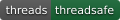
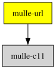

# mulle-url

#### 🈷️ Support for URL parsing

A C (C99) library to check if unicode characters are valid for the various
parts of an URL: scheme, host, user etc.
Used by **NSCharacterSet** extensions of MulleObjCInetFoundation.


| Release Version                                       | Release Notes  | AI Documentation
|-------------------------------------------------------|----------------|---------------
|      [](//github.com/mulle-c/mulle-url/actions) | [RELEASENOTES](RELEASENOTES.md) | [DeepWiki for mulle-url](https://deepwiki.com/mulle-c/mulle-url)


## Documentation & Guides

* [API Summary](asset/dox/api/toc)


### You are here




## Add

### Add mulle-url via mulle-core

mulle-url is a component of the
[mulle-core](//github.com/mulle-core/mulle-core) library.
In your code include its umbrella header:

``` c
#include <mulle-core/mulle-core.h>
```

Add mulle-core to your `CMakeLists.txt` with
[FetchContent](https://cmake.org/cmake/help/latest/module/FetchContent.html):

``` cmake
include( FetchContent)

set( MULLE__CORE_TAG "master" CACHE STRING "branch or tag to fetch mulle-core from")

FetchContent_Declare( MULLE__CORE
   GIT_REPOSITORY https://github.com/mulle-core/mulle-core.git
   GIT_TAG        "${MULLE__CORE_TAG}")
FetchContent_MakeAvailable( MULLE__CORE)

target_link_libraries( ${PROJECT_NAME} PUBLIC mulle-core)
```

Or add to your mulle-sde project with:

``` sh
mulle-sde add mulle-core/mulle-core
```


### Add mulle-url as a cmake subproject

In your code include its header:

``` c
#include <mulle-url/mulle-url.h>
```

Add mulle-url and its dependencies to your `CMakeLists.txt` with
[FetchContent](https://cmake.org/cmake/help/latest/module/FetchContent.html):

``` cmake
include( FetchContent)

include_directories( SYSTEM "${CMAKE_BINARY_DIR}/include")

set( MULLE__C11_TAG "master" CACHE STRING "branch or tag to fetch mulle-c11 from")

FetchContent_Declare( MULLE__C11
   GIT_REPOSITORY https://github.com/mulle-c/mulle-c11.git
   GIT_TAG        "${MULLE__C11_TAG}")
FetchContent_MakeAvailable( MULLE__C11)

set( MULLE__URL_TAG "master" CACHE STRING "branch or tag to fetch mulle-url from")

FetchContent_Declare( MULLE__URL
   GIT_REPOSITORY https://github.com/mulle-c/mulle-url.git
   GIT_TAG        "${MULLE__URL_TAG}")
FetchContent_MakeAvailable( MULLE__URL)

target_link_libraries( ${PROJECT_NAME} PUBLIC mulle-url)
```

Or add to your mulle-sde project with:

``` sh
mulle-sde add github:mulle-c/mulle-url
```

## Individual Install

Install all the prerequisites.

``` bash
PREFIX=/tmp/usr/local
BUILD_DIR="mulle-url/build"

cmake -S "mulle-url" -B "${BUILD_DIR}"    \
  -DCMAKE_BUILD_TYPE="Release"                  \
  -DCMAKE_INSTALL_PREFIX="${PREFIX}"            \
  -DCMAKE_PREFIX_PATH="${PREFIX}"               \
  -DCMAKE_C_FLAGS="-I"${PREFIX}"/include"       \
&& cmake --build "${BUILD_DIR}"  --parallel     \
&& cmake --install "${BUILD_DIR}"
```


## Author

[Nat!](https://mulle-kybernetik.com/weblog) for Mulle kybernetiK  


